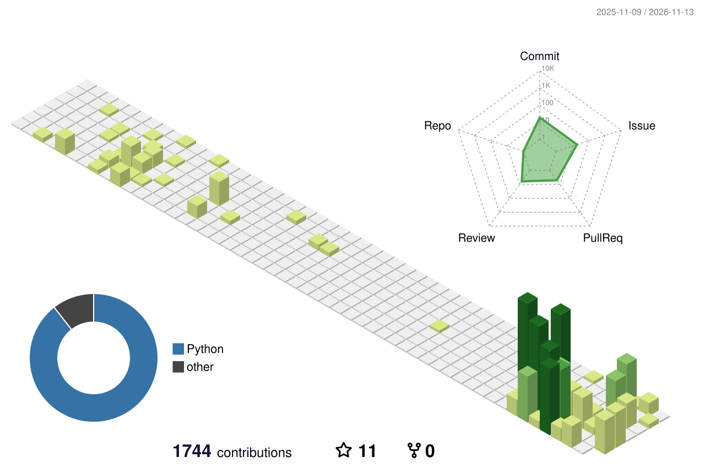

<picture>
  <source media="(prefers-color-scheme: dark)" srcset="./assets/garden-dark.svg">
  
</picture>

**I'm Pietro**, a software engineer and Computer Engineering student based in Italy 🇮🇹.
I like clean architectures, well-tested code and software that respects the people who use it.

## 🌱 What I'm building

**My personal website** *(coming soon)*: a site that grows like a garden. Every article is a plant,
every project a tree. It gathers what I write, code, study and do (gym sessions, trips) and
publishes it only after my approval, with privacy designed into the data model.

| Layer | Stack |
| --- | --- |
| Backend | Django 6 as a headless JSON API · Celery + Redis · PostgreSQL |
| Frontend | Nuxt 4 · custom design system (light and dark themes) · Three.js garden |
| AI | An agent that drafts posts from my week, always labelled, always with a spending cap |
| Workflow | Spec-first · test-driven · independent review before every merge · CI on GitHub Actions |

## 📊 My contributions, in 3D

<picture>
  <source media="(prefers-color-scheme: dark)" srcset="./profile-3d-contrib/profile-night-green.svg">
  
</picture>

Regenerated every day by a GitHub Action.

## 🛠 Technologies and tools

## 📖 Currently learning / improving

## 👾 On my list

## 🔍 Where to find me

&nbsp;

&nbsp;

> *"There is always one more bug to fix."*: Ellen Ullman
